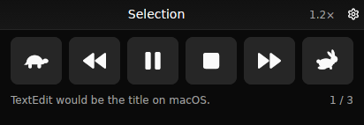
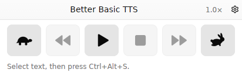
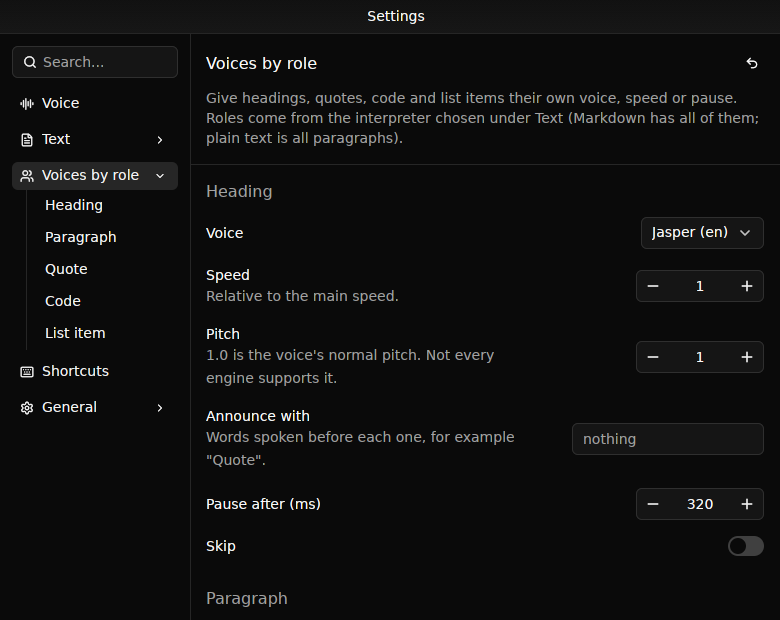

# Better Basic TTS

A small, local, cross-platform text-to-speech controller modelled on the classic
macOS speech panel: **slower · back · play/pause · stop · forward · faster**, and
nothing else you have to learn.





- **Local only.** Speech is produced on your machine by the voices that ship with
  the operating system (or any local engine you plug in). Nothing is sent anywhere.
- **Same controls everywhere.** The app synthesises audio sentence by sentence and
  plays it itself, so pause, skip and speed behave identically on macOS, Windows and
  Linux, whatever engine is behind them.
- **Text is treated as text.** Angle brackets, `[[embedded commands]]`, escape
  sequences and invisible characters can never switch voices, run markup or get
  silently dropped. `Vec<String>` is read as "Vec of String", `a < b` as "a less
  than b", `<script>` as "script tag".
- **Global shortcut.** Select text anywhere, press a key, hear it.
- **Customisable when you want it.** Markdown headings, quotes, code and list items
  can each have their own voice, speed, pitch, pause or spoken announcement.

Written in Rust with [GPUI](https://www.gpui.rs/) and [GPUI Kit](https://gpui-kit.com).

## Status

Early but working.

| Platform | State |
|----------|-------|
| Linux (X11) | developed and exercised end to end: panel, mouse and keyboard, global shortcut, remote control, settings, eSpeak NG and KittenTTS voices |
| macOS, Windows | built, unit-tested and smoke-tested in CI (including synthesising speech with the system voices to a file); the window, global shortcut and selection capture have **not yet been used by a person** |
| Linux (Wayland) | should work with the CLI commands bound to keys; untested |

See [Known limitations](#known-limitations).

## Using it

Start `better-basic-tts`. A small panel appears.

| Button | Does | Key (panel focused) |
|--------|------|---------------------|
| 🐢 | slower (0.25× steps, applies immediately, mid-sentence) | `↓` or `-` |
| ⏪ | restart the sentence; press again to go to the previous one | `←` |
| ⏯ | pause / resume. With nothing loaded: read the clipboard | `Space` |
| ⏹ | stop | `Esc` |
| ⏩ | next sentence | `→` |
| 🐇 | faster | `↑` or `=` |

Paste (`Ctrl+V` / `⌘V`) into the panel to read the clipboard. The gear opens the
settings:



### Global shortcuts

| Default | Action |
|---------|--------|
| `Ctrl+Alt+S` (`⌃⌥S` on macOS) | read the selected text; press again to stop |
| `Ctrl+Alt+P` | pause / resume |

Every transport action can have a global shortcut; set them under
**Settings → Shortcuts** (written like `Ctrl+Alt+S`, `Cmd+Shift+S`, `Alt+F9`).

How the selection is obtained:

| Platform | Mechanism |
|----------|-----------|
| Linux (X11, Wayland) | the *primary selection* — selected text is already available, nothing is simulated |
| macOS | the Accessibility API (`AXSelectedText`); if the app does not expose it, a simulated `⌘C` whose clipboard change is undone |
| Windows | a simulated `Ctrl+C` whose clipboard change is undone |

macOS asks for the **Accessibility** permission the first time (System Settings →
Privacy & Security → Accessibility).

**Wayland** does not let applications register global shortcuts. Bind these commands
in your desktop's keyboard settings instead — they talk to the running panel (and
start it if needed):

```bash
better-basic-tts speak-selection
```

```bash
better-basic-tts pause
```

### Command line

```
better-basic-tts                     open the panel
better-basic-tts speak "text"        read text (also: --file FILE, or piped stdin)
better-basic-tts speak -o out.wav …  write a WAV file instead of playing
better-basic-tts speak --no-gui …    speak from the terminal and wait
better-basic-tts speak-selection | speak-clipboard
better-basic-tts pause | stop | previous | next | slower | faster | show
better-basic-tts engines             speech engines found on this computer
better-basic-tts voices              voices of the active engine
better-basic-tts explain "text"      show how text is split and what is spoken
better-basic-tts benchmark           how fast the engine is compared to playback
```

If reading ever pauses between sentences, `benchmark` shows whether the speech engine
is the reason (it compares how long each sentence takes to produce with how long it
takes to play, at your current speed and voice).

`explain` is handy for checking interpretation rules:

```
$ better-basic-tts explain 'Use Vec<String> when a < b. <script>alert(1)</script>'
  1 [paragraph] Use Vec<String> when a < b.
      spoken as: Use Vec of String when a less than b.
  2 [paragraph] <script>alert(1)</script>
      spoken as: script tag alert(1) closing script tag
```

## Engines

| id | Platform | Backend |
|----|----------|---------|
| `say` | macOS | the system voices, through `/usr/bin/say` |
| `winrt` | Windows 10+ | the system voices, `Windows.Media.SpeechSynthesis` |
| `espeak` | any; default on Linux | [eSpeak NG](https://github.com/espeak-ng/espeak-ng) if installed |
| *yours* | any | any local program that produces a WAV (see below) |

Linux has no bundled system voice, so install eSpeak NG as the baseline:

```bash
sudo apt install espeak-ng
```

eSpeak is clear but robotic. For natural-sounding voices on Linux (or anywhere), use
one of the neural adapters in [`contrib/engines`](contrib/engines/README.md):
**KittenTTS** (small, fast on a CPU, tested) or **NeuTTS** (voice cloning).

### Plugging in another local engine

Anything that can turn text into a WAV file can be an engine. Add it to the settings
file (`Settings → General → Open file`):

```toml
[[engines]]
id = "piper"
name = "Piper"
program = "piper"
args = ["--model", "{voice}", "--length_scale", "{length_scale}", "--output_file", "{output}"]
voices = ["/home/me/voices/en_US-lessac-medium.onnx"]
```

The text is piped to the program's standard input (or written to a temp file if an
argument contains `{input}`); it is never placed on the command line and no shell is
involved. Placeholders: `{voice}`, `{rate}`, `{length_scale}` (= 1/rate), `{wpm}`,
`{pitch}`, `{output}`, `{input}`. Without `{output}` the WAV is read from standard
output; with `raw_sample_rate = 22050` standard output is taken as raw 16-bit mono
PCM instead.

Engines that are slow to start (neural models) should set `persistent = true` and
speak the small JSON line protocol described in
[`contrib/engines`](contrib/engines/README.md), so the model is loaded once.

## Customising how text is read

Everything lives in one TOML file, and most of it is editable in the settings window.

```toml
appearance = "system"      # system | light | dark
engine = "auto"            # or "say", "winrt", "espeak", or one of yours
voice = ""                 # empty = the engine's default voice
rate = 1.2
interpreter = "auto"       # auto | plain | markdown
angle_brackets = "smart"   # smart | literal | strip_tags | silent
urls = "domain"            # domain | full | skip

# One voice for headings, another for quotes, skip code blocks.
[roles.heading]
voice = "Daniel"
rate = 0.9
pause_after_ms = 600

[roles.quote]
voice = "Samantha"
announce = "Quote."

[roles.code]
skip = true

# Pronunciation fixes, applied before anything else.
[[substitutions]]
pattern = "GPUI"
replacement = "G P U I"
case_sensitive = true

[[substitutions]]
pattern = 'v(\d+)\.(\d+)'
replacement = "version $1 point $2"
regex = true
roles = ["heading"]
```

### How it works

```
raw text → sanitize → interpreter → [block: role + text] → sentences → speakable → engine → player
```

1. **Sanitize** — control characters, escape sequences and invisible / bidi
   characters are removed.
2. **Interpreter** — assigns a *role* (heading, paragraph, quote, code, list item) to
   each block. Plain text and Markdown are built in; this is the extension point for
   new formats (`crates/core/src/text/interpret.rs`).
3. **Speakable** — URLs, your substitutions, then angle brackets. After this step the
   text sent to an engine contains no `<` or `>` at all, so no engine can mistake it
   for SSML or HTML.
4. **Role styles** — pick voice, rate, pitch, volume, announcement and pauses.
5. **Engine** — one sentence in, PCM out. Up to six sentences are prepared ahead, and
   each one is handed to the audio stream before the previous one ends, so sentences
   follow each other without a seam.
6. **Player** — owns the transport.

## Building

Requires a recent stable Rust toolchain.

```bash
cargo build --release -p better-basic-tts
```

Linux build dependencies (Debian / Ubuntu names):

```bash
sudo apt install libxkbcommon-dev libxkbcommon-x11-dev libwayland-dev libx11-dev libx11-xcb-dev libxcb1-dev libasound2-dev libfontconfig-dev libfreetype-dev
```

macOS: wrap the binary in an app bundle so the Accessibility permission sticks:

```bash
scripts/bundle-macos.sh
```

Run the tests:

```bash
cargo test --workspace
```

### Layout

| Crate | What |
|-------|------|
| `crates/core` | text pipeline, engines, playback state machine, settings — no UI, fully unit-tested |
| `crates/platform` | global shortcuts, selection capture, single-instance IPC, always-on-top |
| `crates/app` | the GPUI panel, the settings window and the CLI |

## Known limitations

- **macOS / Windows are lightly tested.** They build and pass CI, but the simulated
  copy, the Accessibility lookup and the window behaviour need real-world use.
- The panel is the application: closing it quits, and global shortcuts only work
  while it is running (minimise it instead).
- **Wayland:** no global shortcuts (use the CLI commands above) and no
  always-on-top (use the compositor's "keep above").
- **macOS "keep on top"** changes apply at the next start.
- The simulated copy on macOS / Windows restores *text* clipboard contents; a copied
  image or file would be replaced by the selection.
- Navigation is by sentence; there is no word highlighting.
- No tray icon and no remembered window position yet.

## License

Boost Software License 1.0 — see [LICENSE](LICENSE). The turtle-and-rabbit transport
icons are original to this project.
